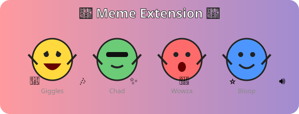
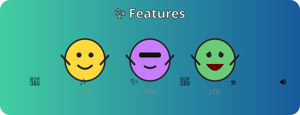
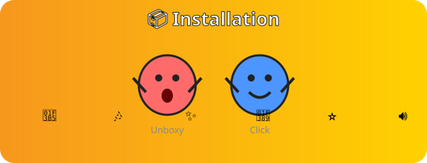
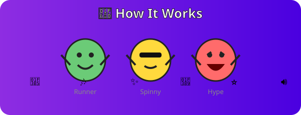
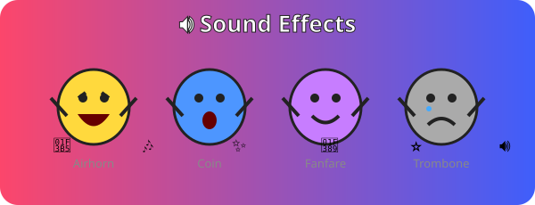
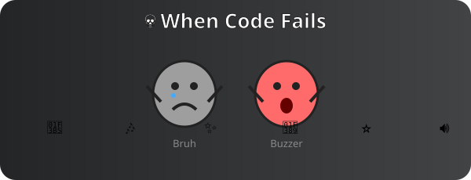
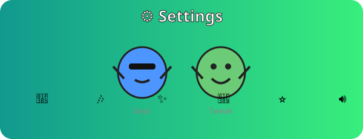
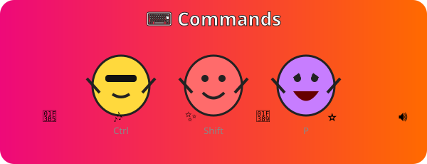
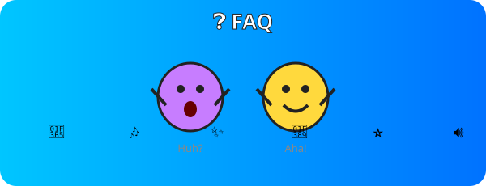
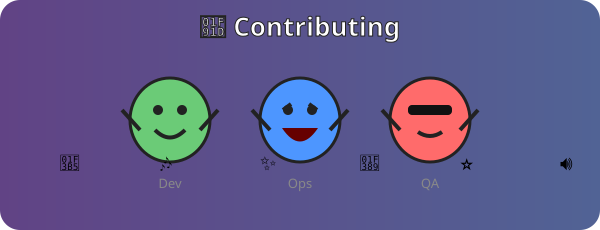

<div align="center">



# 🎉 Meme Extension for VS Code

**Your code ran successfully? You deserve an airhorn. 📯**

Meme Extension plays funny, celebratory sound effects and shows hilarious messages every time your code runs successfully — and a sad trombone when it doesn't.

[](https://github.com/devlopergit04/Meme-Extension/releases)


</div>

---

## 📚 Table of Contents

1. [Features](#-features)
2. [Installation](#-installation)
3. [How It Works](#-how-it-works)
4. [Sound Effects](#-sound-effects)
5. [When Code Fails](#-when-code-fails)
6. [Settings](#️-settings)
7. [Commands](#️-commands)
8. [FAQ](#-faq)
9. [Contributing](#-contributing)
10. [License](#-license--thanks)

---

## ✨ Features



- 🎺 **Success sounds** – tada, airhorn, coin, level-up and fanfare, chosen at random.
- 💬 **Funny messages** – "🐐 You are the GOAT.", "😎 First try. Totally planned." and more.
- 💀 **Fail sounds** – sad trombone, "bruh" and buzzer when the exit code isn't `0`.
- 🖥️ **Terminal detection** – works with VS Code shell integration (any command you type).
- 🐞 **Run & Debug detection** – reacts when a debug/run session (F5 / Ctrl+F5) exits.
- 🛠️ **Task detection** – reacts when a VS Code task finishes.
- 🔇 **Status bar toggle** – one click to mute or unmute.
- 🎚️ **Volume control** – set how loud the chaos should be.
- 🪶 **Lightweight** – zero dependencies, sounds are tiny original 8-bit WAV files.

---

## 📦 Installation



### Option A — From GitHub Releases (recommended)

1. Go to the [**Releases**](https://github.com/devlopergit04/Meme-Extension/releases) page.
2. Download `meme-extension-1.0.0.vsix`.
3. In VS Code open the Command Palette (`Ctrl+Shift+P` / `Cmd+Shift+P`).
4. Run **Extensions: Install from VSIX...** and pick the file.

### Option B — Command line

```bash
code --install-extension meme-extension-1.0.0.vsix
```

### Option C — Build from source

```bash
git clone https://github.com/devlopergit04/Meme-Extension.git
cd Meme-Extension
npx @vscode/vsce package
code --install-extension meme-extension-1.0.0.vsix
```

---

## 🚀 How It Works



| Source | Trigger | Success when |
|-------|---------|--------------|
| 🖥️ Terminal | A command finishes (shell integration) | exit code `0` |
| 🐞 Run/Debug | A debug session ends | exit code `0` |
| 🛠️ Tasks | A task process ends | exit code `0` |

The first time a sound plays, a small **🎵 Meme Player** tab opens beside your editor. VS Code extensions can only play audio from a webview, so keep this tab open (it can stay in the background) and the fun keeps flowing.

> 💡 **Tip:** Terminal detection needs *shell integration*, which is on by default for bash, zsh, fish and PowerShell.

---

## 🔊 Sound Effects



| Sound | Vibe | Plays on |
|------|------|---------|
| 🎉 `tada` | Classic victory | Success |
| 📯 `airhorn` | MLG energy | Success |
| 🪙 `coin` | Retro collect | Success |
| ⬆️ `levelup` | You gained XP | Success |
| 🎺 `fanfare` | Royal entrance | Success |
| 🎺 `trombone` | Wah wah wah waaah | Failure |
| 😐 `bruh` | Self explanatory | Failure |
| 🚨 `buzzer` | Game-show wrong answer | Failure |

All sounds are original, synthesized chiptune effects and live in `media/sounds/`. Replace them with your own `.wav` files (same names) to customize.

---

## 💀 When Code Fails



Not every run is a win. When something exits with a non-zero code you'll get a random fail sound and a message like:

- 💀 *Bruh.*
- 🔥 *This is fine.*
- 🤡 *Have you tried turning it off and on again?*

Don't like being roasted? Set `memeExtension.playOnFailure` to `false`.

---

## ⚙️ Settings



| Setting | Type | Default | Description |
|--------|------|---------|-------------|
| `memeExtension.enabled` | boolean | `true` | Turn sounds on/off |
| `memeExtension.playOnFailure` | boolean | `true` | Play sounds on failures too |
| `memeExtension.showMessages` | boolean | `true` | Show funny notifications |
| `memeExtension.volume` | number | `0.8` | Volume between `0` and `1` |

```json
{
  "memeExtension.volume": 1,
  "memeExtension.playOnFailure": true
}
```

---

## ⌨️ Commands



| Command | What it does |
|--------|--------------|
| `Meme: Play Success Sound` | Celebrate manually 🎉 |
| `Meme: Play Fail Sound` | Roast yourself manually 💀 |
| `Meme: Toggle On/Off` | Mute / unmute (also via status bar) |

---

## ❓ FAQ



<details><summary><b>I don't hear anything!</b></summary>

Make sure the **🎵 Meme Player** tab is open, your system volume is up, and `memeExtension.enabled` is `true`. Try `Meme: Play Success Sound`.
</details>

<details><summary><b>Terminal commands don't trigger sounds.</b></summary>

Enable shell integration: `"terminal.integrated.shellIntegration.enabled": true`, then open a new terminal.
</details>

<details><summary><b>Can I use my own sounds?</b></summary>

Yes! Replace the files in `media/sounds/` inside the extension folder with your own `.wav` files using the same names.
</details>

<details><summary><b>Will this annoy my coworkers?</b></summary>

Absolutely. That's the point. 😎 (Use headphones.)
</details>

---

## 🤝 Contributing



1. 🍴 Fork the repo
2. 🌿 Create a branch: `git checkout -b feature/more-memes`
3. 💾 Commit your changes
4. 📤 Push and open a Pull Request

Ideas welcome: new sounds, more messages, per-language reactions, meme images in the player…

### Project structure

```
Meme-Extension/
├── src/extension.js      # Extension logic
├── media/sounds/*.wav    # Sound effects
├── assets/*.svg          # Animated README characters
└── package.json          # Extension manifest
```

---

## 📜 License & Thanks


Released under the **MIT License**. Made with ❤️, ☕ and way too many airhorns.

<div align="center"><b>If it made you laugh, give it a ⭐!</b></div>
